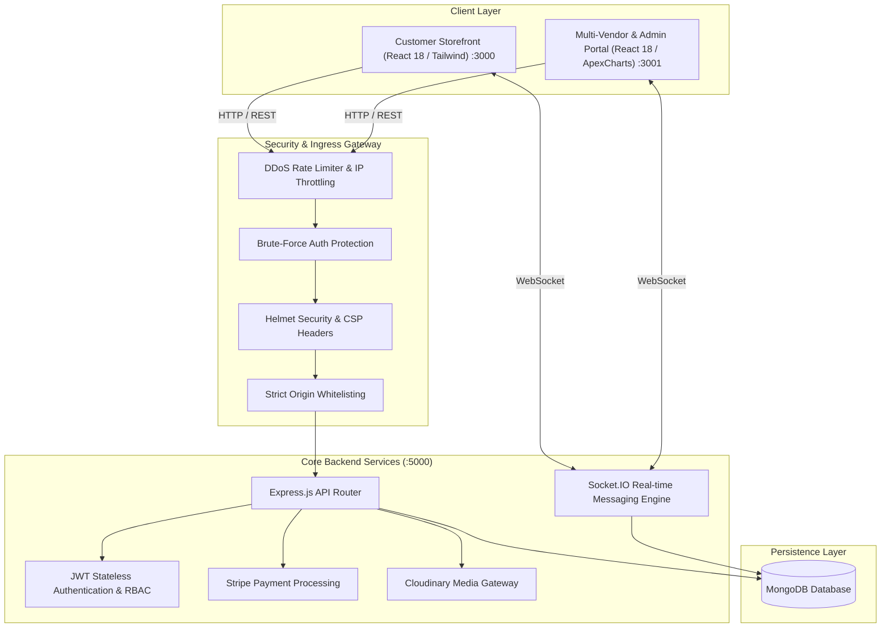

# Craftoras 🛍️✨

[](https://github.com/Craftoras/craftoras/actions/workflows/ci.yml)
[](https://github.com/Craftoras/craftoras/actions/workflows/security.yml)
[](https://nodejs.org/)
[](https://react.dev/)
[](https://expressjs.com/)
[](https://www.mongodb.com/)
[](https://socket.io/)
[](https://tailwindcss.com/)
[](docker-compose.yml)
[](https://zenodo.org/badge/latestdoi/1460295878)
[](LICENSE)
[](SECURITY.md)
[](CONTRIBUTING.md)
[](https://github.com/darrehanrasool)

> **Craftoras** is an enterprise-ready, multi-vendor e-commerce platform engineered to connect authentic Kashmiri artisanal heritage—such as hand-spun Pashmina shawls, silk hand-knotted carpets, walnut wood carvings, papier-mâché, and crewel embroidery—with global collectors and patrons.

---

## 📑 Table of Contents

- [System Architecture](#-system-architecture)
- [DDoS Mitigation & Security Architecture](#-ddos-mitigation--security-architecture)
- [Monorepo Structure](#-monorepo-structure)
- [Core Features](#-core-features)
- [Prerequisites](#-prerequisites)
- [Quick Start & Local Development](#-quick-start--local-development)
- [Docker Compose Deployment](#-docker-compose-deployment)
- [Environment Variables](#-environment-variables)
- [API Reference](#-api-reference)
- [Automated Testing & Quality Assurance](#-automated-testing--quality-assurance)
- [CI/CD Pipelines](#-cicd-pipelines)
- [Contributing & Governance](#-contributing--governance)
- [Authors & License](#-authors--license)

---

## 🏛 System Architecture

The platform follows a decoupled, three-tier microservice/monorepo architecture with real-time bidirectional WebSocket orchestration:



---

## 🛡 DDoS Mitigation & Security Architecture

Craftoras implements defense-in-depth security principles engineered to resist high-volume Denial of Service (DoS/DDoS), brute-force attacks, and common web application vulnerabilities (OWASP Top 10):

### 1. Layer 7 DDoS Rate Limiting
- **Global API Throttling**: Protected by `express-rate-limit` allowing up to **1,500 requests per 15-minute window** per client IP on `/api/*` endpoints.
- **Strict Authentication Limiting**: Brute-force and credential-stuffing prevention on `/api/admin-login`, `/api/seller-login`, and `/api/customer/*` throttled to **50 requests per 15-minute window** per IP.
- **Rate Limit Headers**: Returns RFC-compliant `RateLimit-Limit`, `RateLimit-Remaining`, and `RateLimit-Reset` HTTP headers for client back-off signaling.

### 2. HTTP Flood & Resource Exhaustion Defense
- **Payload Size Limits**: Strict 10MB body parser ceiling (`bodyParser.json({ limit: '10mb' })`) preventing memory exhaustion attacks via oversized JSON or URL-encoded payloads.
- **Fail-Fast Database Queries**: Mongoose connection includes `serverSelectionTimeoutMS: 3000` to prevent thread hanging during network partitioning.

### 3. Header Hardening (Helmet)
- Enforces `X-Content-Type-Options: nosniff` to defend against MIME-type sniffing.
- Enforces `X-Frame-Options: SAMEORIGIN` to thwart clickjacking.
- Cross-Origin Resource Policy (CORP) isolation.

### 4. Zero-Trust Access Control
- **Stateless JWT**: Ephemeral 7-day cryptographically signed JSON Web Tokens stored in secure HTTP-only cookies.
- **Role-Based Access Control (RBAC)**: Enforced via `authMiddleware` verifying separate scopes for `admin`, `seller`, and `customer`.
- **Bcrypt Salt Hashing**: Password hashes generated with 10 salt rounds.

---

## 📂 Monorepo Structure

```text
craftoras/
├── .github/
│   └── workflows/
│       ├── ci.yml                 # Automated CI tests & builds for all 3 tiers
│       └── security.yml           # CodeQL static analysis & npm vulnerability audit
├── backend/                       # Express.js REST API & Socket.IO server
│   ├── controllers/               # Business logic (auth, dashboard, home, order, payment, chat)
│   ├── middlewares/               # JWT authentication & authorization middleware
│   ├── models/                    # Mongoose database schemas & models
│   ├── routes/                    # Express modular route definitions
│   ├── utiles/                    # Database connection, tokens, pagination helpers
│   ├── tests/                     # Automated API, security & unit tests (node:test)
│   ├── Dockerfile                 # Container image specification
│   ├── .env.example               # Backend environment variable template
│   └── server.js                  # Application entry point with DDoS protection
├── dashboard/                     # Multi-vendor Admin & Artisan seller portal
│   ├── src/
│   │   ├── api/                   # Axios API client
│   │   ├── layout/                # Responsive navigation & sidebar layout
│   │   ├── router/                # Role-based route definitions (admin vs seller)
│   │   ├── store/                 # Redux Toolkit state slices & async thunks
│   │   └── views/                 # Analytics, Category, Product, Order & Chat views
│   ├── Dockerfile                 # Production multi-stage Docker build with Nginx
│   └── package.json               # Scripts & dependencies
├── frontend/                      # Customer-facing e-commerce storefront
│   ├── src/
│   │   ├── api/                   # Axios API client
│   │   ├── components/            # Reusable UI widgets (Banner, Reviews, Carousel)
│   │   ├── pages/                 # Home, Shops, Product Details, Cart, Checkout, Profile
│   │   └── store/                 # Redux Toolkit state slices
│   ├── Dockerfile                 # Production multi-stage Docker build with Nginx
│   └── package.json               # Scripts & dependencies
├── .gitignore                     # Monorepo ignore rules
├── docker-compose.yml             # Orchestration for MongoDB, Backend, Frontend, Dashboard
├── package.json                   # Root monorepo orchestration scripts
├── CODE_OF_CONDUCT.md             # Contributor Covenant 2.1
├── CONTRIBUTING.md                # Development standards & PR process
├── LICENSE                        # MIT Open Source License
└── SECURITY.md                    # Vulnerability reporting protocols
```

---

## 🌟 Core Features

| Module | Feature Capabilities |
| :--- | :--- |
| **Storefront (`frontend`)** | Product discovery, filtering by price/rating/category, rich artisan showcase, shopping cart, customer wishlist, Stripe card checkout, real-time seller chat. |
| **Dashboard (`dashboard`)** | **Admin**: Platform sales metrics, seller KYC verification, category management, payout clearance.<br>**Artisan/Seller**: Product inventory management, discount management, order fulfillment, Stripe payout onboarding, customer messaging. |
| **Backend Core (`backend`)** | Modular REST API, Socket.IO real-time event broker, Cloudinary CDN integration, JWT cookie management, rate-limiting DDoS filters. |

---

## 📋 Prerequisites

Ensure the following runtimes and tools are installed:
- **Node.js**: `v20.x` or higher (`v24.x` supported)
- **npm**: `v10.x` or higher
- **MongoDB**: `v6.0+` or MongoDB Atlas cloud instance
- **Docker & Docker Compose** (Optional, for containerized execution)

---

## 🚀 Quick Start & Local Development

### 1. Clone the Repository
```bash
git clone https://github.com/Craftoras/craftoras.git
cd craftoras
```

### 2. Configure Environment Files
```bash
cp backend/.env.example backend/.env
cp frontend/.env.example frontend/.env
cp dashboard/.env.example dashboard/.env
```
*(Fill in your MongoDB connection string and credentials in `backend/.env`)*

### 3. Install Dependencies
Run in separate terminals or across workspaces:
```bash
# Backend
cd backend && npm install

# Multi-Vendor Dashboard
cd ../dashboard && npm install

# Customer Storefront
cd ../frontend && npm install
```

### 4. Run the Full Application Suite

From the repository root:
```bash
# Terminal 1: Backend API Server (Runs on :5000, falls back to :5001 if :5000 is occupied)
npm run start:backend

# Terminal 2: Multi-Vendor Dashboard (Runs on :3001)
npm run start:dashboard

# Terminal 3: Customer Storefront (Runs on :3000)
npm run start:frontend
```

Now open:
- **Storefront**: [http://localhost:3000](http://localhost:3000)
- **Seller/Admin Dashboard**: [http://localhost:3001](http://localhost:3001)
- **Backend Health Check**: [http://localhost:5000/api/health](http://localhost:5000/api/health)

---

## 🐳 Docker Compose Deployment

Run the entire platform (MongoDB + Backend + Frontend + Dashboard) with one command:

```bash
docker compose up --build
```

To stop containers:
```bash
docker compose down
```

---

## ⚙️ Environment Variables

### Backend (`backend/.env`)
| Variable | Description | Default |
| :--- | :--- | :--- |
| `PORT` | API server listen port | `5000` |
| `DB_URL` | MongoDB connection URI | `mongodb://127.0.0.1:27017/ec` |
| `SECRET` | JWT signing secret | `your_secret_key` |
| `cloud_name` | Cloudinary cloud identifier | `dbx` |
| `api_key` | Cloudinary API key | `5833` |
| `api_secret` | Cloudinary API secret | `yY0` |
| `STRIPE_KEY` | Stripe secret key for payment intents | `sk_test_...` |
| `CLIENT_URL` | Frontend origin for CORS | `http://localhost:3000` |

### Frontend & Dashboard (`.env`)
| Variable | Description | Default |
| :--- | :--- | :--- |
| `REACT_APP_API_URL` | Backend REST API endpoint | `http://localhost:5000` |
| `REACT_APP_STRIPE_KEY` | Stripe publishable key | `pk_test_...` |
| `PORT` | Frontend/Dashboard port | `3000` (frontend) / `3001` (dashboard) |

---

## 🔌 API Reference

### Health & System
| Method | Endpoint | Description |
| :--- | :--- | :--- |
| `GET` | `/` | API welcome check |
| `GET` | `/api/health` | Service uptime and health telemetry |

### Authentication & Authorization
| Method | Endpoint | Description | Rate Limit |
| :--- | :--- | :--- | :--- |
| `POST` | `/api/admin-login` | Admin portal authentication | 50 req / 15 min |
| `POST` | `/api/seller-login` | Artisan seller login | 50 req / 15 min |
| `POST` | `/api/seller-register` | Artisan seller registration | 50 req / 15 min |
| `POST` | `/api/customer/customer-login` | Customer login | 50 req / 15 min |
| `POST` | `/api/customer/customer-register` | Customer account registration | 50 req / 15 min |
| `GET` | `/api/get-user` | Retrieve authenticated user profile | 1,500 req / 15 min |

### Catalog & Commerce
| Method | Endpoint | Description |
| :--- | :--- | :--- |
| `GET` | `/api/home/get-categorys` | Retrieve all handicraft categories |
| `GET` | `/api/home/get-products` | Fetch featured, top-rated & latest products |
| `GET` | `/api/home/query-products` | Advanced search, category and price filtering |
| `GET` | `/api/home/product-details/:slug` | Retrieve single product with reviews & related items |
| `POST` | `/api/home/product/add-to-card` | Add item to customer shopping cart |
| `GET` | `/api/home/product/get-card-product/:userId` | Get customer cart items & totals |
| `POST` | `/api/order/create-payment` | Initialize Stripe PaymentIntent |

---

## 🧪 Automated Testing & Quality Assurance

Craftoras enforces rigorous test automation across backend APIs and frontend user interfaces:

```bash
# Run all tests across the monorepo
npm test

# Run backend unit, security & route tests
npm run test:backend

# Run dashboard component & Redux tests
npm run test:dashboard

# Run frontend customer storefront tests
npm run test:frontend
```

---

## 🔄 CI/CD Pipelines

Our automated GitHub Actions workflows ensure continuous code quality and security verification:

1. **Continuous Integration (`.github/workflows/ci.yml`)**:
   - Executes matrix tests across Node.js versions `20.x` and `22.x`.
   - Validates backend route assertions, rate limiters, and authentication logic.
   - Executes React component tests and verifies production production builds for both `frontend` and `dashboard`.

2. **Security & CodeQL Analysis (`.github/workflows/security.yml`)**:
   - Performs automated AST static analysis via GitHub CodeQL for JavaScript/TypeScript.
   - Executes dependency audits (`npm audit`) against known high/critical CVEs.

---

## 🤝 Contributing & Governance

Contributions to empower authentic Kashmiri artisans and enhance this platform are welcome!

1. Read our [Code of Conduct](CODE_OF_CONDUCT.md).
2. Follow the [Contributing Guidelines](CONTRIBUTING.md).
3. Use Conventional Commits (`feat:`, `fix:`, `docs:`, `security:`).
4. Ensure `npm test` passes before submitting your Pull Request.

---

## 👥 Authors & Maintainers

- **[Dar Rehan Rasool](https://github.com/darrehanrasool)** — *Project Architect & Maintainer*
- **[Shafiya Bashir](https://github.com/shafiyabashirpampori)** — *Contributor*

---

## 📄 License

This project is licensed under the terms of the [MIT License](LICENSE).
