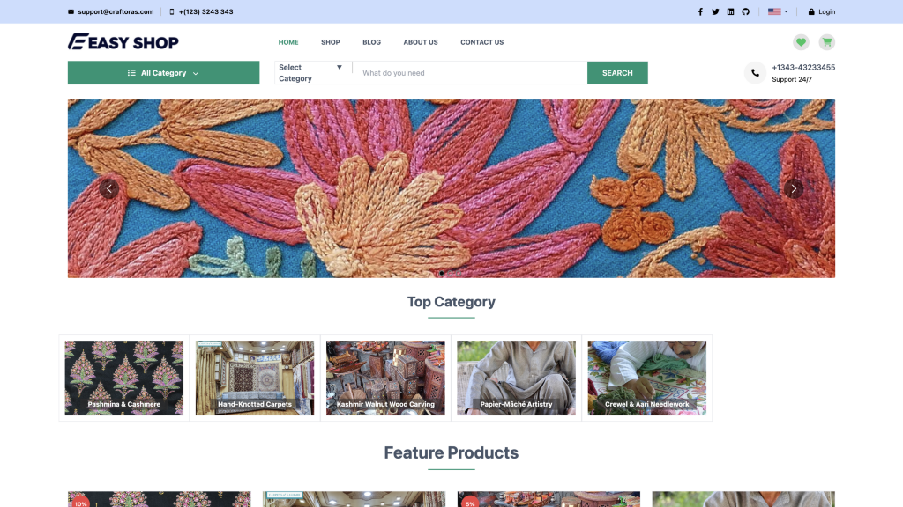
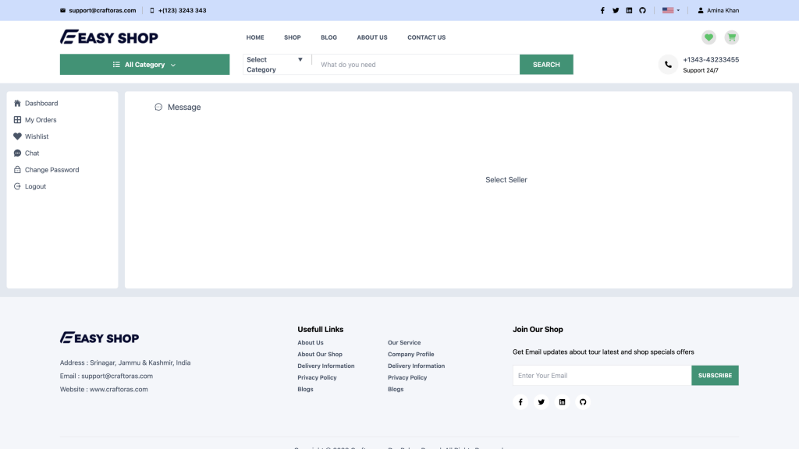
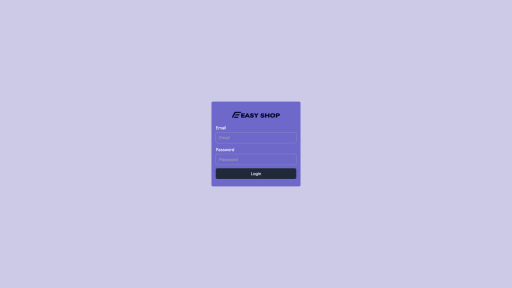
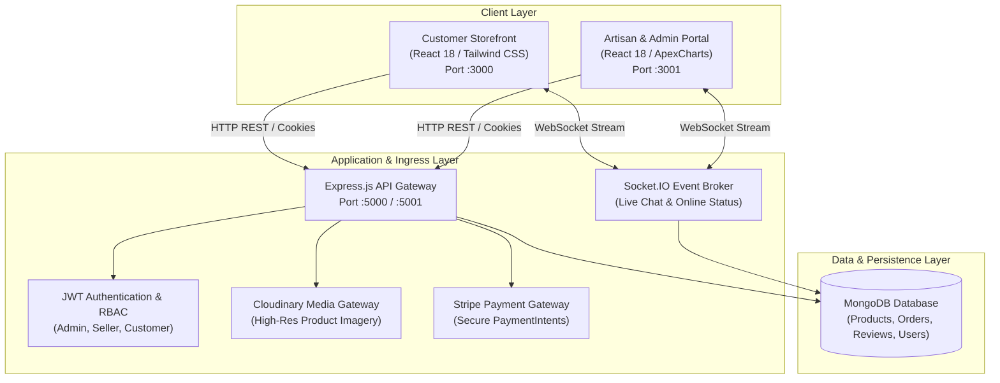

# Craftoras

[](https://github.com/Craftoras/craftoras/actions/workflows/ci.yml)
[](https://github.com/Craftoras/craftoras/actions/workflows/security.yml)
[](https://nodejs.org/)
[](https://react.dev/)
[](https://expressjs.com/)
[](https://www.mongodb.com/)
[](https://socket.io/)
[](https://tailwindcss.com/)
[](docker-compose.yml)
[](https://zenodo.org/badge/latestdoi/1460295878)
[](LICENSE)
[](https://github.com/darrehanrasool)
[](https://github.com/darrehanrasool)
[](CONTRIBUTING.md)

> **Craftoras** is a modern multi-vendor e-commerce platform engineered to connect authentic Kashmiri artisanal heritage—such as hand-spun Pashmina shawls, silk hand-knotted carpets, walnut wood carvings, papier-mâché, and crewel embroidery—with global patrons and connoisseurs.

---

## 🖥️ Live Platform Interfaces

<div align="center">
  
  <p><em>Craftoras Customer Storefront — Responsive Kashmiri artisan marketplace featuring Pashmina, Hand-Knotted Carpets, Walnut Wood Carving, Papier-Mâché, and Crewel & Aari Needlework.</em></p>
</div>

<div align="center">
  
  <p><em>Real-Time Customer–Artisan Live Chat — Socket.IO-powered messaging between patrons and Kashmiri craft sellers.</em></p>
</div>

<div align="center">
  
  <p><em>Craftoras Admin & Seller Portal — Dedicated control center for artisan verification, catalog management, and order fulfillment.</em></p>
</div>

---

## Table of Contents

1. [Project Team & Supervision](#-project-team--supervision)
2. [About Craftoras](#about-craftoras)
3. [Featured Artisanal Collections](#featured-artisanal-collections)
4. [System Architecture](#system-architecture)
5. [Monorepo Structure](#monorepo-structure)
6. [Core Modules & Capabilities](#core-modules--capabilities)
7. [Technology Stack](#technology-stack)
8. [Prerequisites](#prerequisites)
9. [Quick Start & Local Development](#quick-start--local-development)
10. [Docker Compose Deployment](#docker-compose-deployment)
11. [Environment Configuration](#environment-configuration)
12. [REST API Reference](#rest-api-reference)
13. [Automated Testing & Quality Assurance](#automated-testing--quality-assurance)
14. [CI/CD Pipelines](#cicd-pipelines)
15. [Contributing & Governance](#contributing--governance)
16. [Future Roadmap & Planned AI Integration](#future-roadmap--planned-ai-integration)
17. [Citation](#citation)
18. [License](#license)

---

## 👥 Project Team & Supervision

This e-commerce platform is developed under faculty supervision:

| Role | Name | Designation & Affiliation | Project & Engineering Contribution |
| :--- | :--- | :--- | :--- |
| **Faculty Supervisor** | **Dr. Muzafer Rasool\*** | Professor & Faculty Supervisor, Centre for Artificial Intelligence (CAI) | Project Guidance, Academic Supervision & Architecture Advisory |
| **Project Lead & Architecture** | [**Dar Rehan Rasool**](https://github.com/darrehanrasool) | M.Tech Student, Centre for Artificial Intelligence, IUST | Full-Stack Platform Architecture, Multi-Vendor Engine, Real-time WebSockets & Payment Gateway |
| **Contributing Student** | [**Muneeb Syed Shah**](https://github.com/muneebsyed-oss) | M.Tech Student, Centre for Artificial Intelligence, IUST | Marketplace Business Logic, Artisan Workflow Testing & Platform Engineering |
| **Contributing Student** | [**Shafiya Bashir Pampori**](https://github.com/shafiyabashirpampori) | M.Tech Student, Centre for Artificial Intelligence, IUST | Artisan Metadata Modeling, Craft Taxonomy Curation & Quality Analysis |

- **Academic Unit**: Centre for Artificial Intelligence (CAI)
- **Institution**: Islamic University of Science and Technology (IUST), Awantipora, Jammu & Kashmir, India
- **Copyright & Handle**: `@darrehanrasool` • [GitHub: darrehanrasool](https://github.com/darrehanrasool)
- *\* Denotes supervising faculty mentor.*

---

## About Craftoras

Craftoras bridges authentic centuries-old Himalayan artisan traditions with modern digital commerce. Handcrafted goods from master weavers, woodcarvers, and artisans often struggle with supply chain opacity, counterfeit challenges, and middleman markups. 

Craftoras empowers local master craftspeople with:
- **Direct Artisan-to-Consumer Market Access**: Dedicated seller storefronts and inventory control.
- **Cultural Preservation**: Curated craft storytelling, artisan profiles, and transparent workshop origins.
- **Fair Economic Value**: Transparent payout management and digital wallets for artisans.
- **Real-Time Customer Connection**: Direct messaging between patrons and artisan workshops.

---

## Featured Artisanal Collections

- **Pashmina & Cashmere**: Hand-spun on traditional spinning wheels (*charkha*) and woven on centuries-old handlooms from Changthangi goat fiber.
- **Hand-Knotted Carpets**: Intricate silk-on-silk and wool rugs patterned with traditional floral, hunting, and medallion motifs.
- **Kashmir Walnut Wood Carving**: Deeply hand-chiseled furniture, screens, and keepsake boxes crafted from seasoned wild walnut trees.
- **Papier-Mâché Artistry**: Finely molded paper pulp hand-painted with pure gold leaf and botanical gouache paints (*Naqashi*).
- **Crewel & Aari Needlework**: Hand-embroidered floral tapestries, cushion covers, and wearables crafted with pointed hooked needles (*aari*).

---

## System Architecture

Craftoras operates as a decoupled three-tier monorepo architecture:



---

## Monorepo Structure

```text
craftoras/
├── .github/
│   └── workflows/
│       ├── ci.yml                 # Matrix testing & production builds for all 3 tiers
│       └── security.yml           # CodeQL static analysis & dependency audit
├── assets/                        # Storefront and platform screenshot assets
│   └── storefront.png             # Customer portal UI capture
├── backend/                       # Express.js REST API & Socket.IO server
│   ├── controllers/               # E-commerce controllers (auth, catalog, cart, orders, payments, chat)
│   ├── middlewares/               # JWT authentication & role-based route guards
│   ├── models/                    # Mongoose schemas (product, order, category, seller, review, wallet)
│   ├── routes/                    # Modular Express routes
│   ├── utiles/                    # Database connection, query filters, tokens, responses
│   ├── tests/                     # Automated unit and API test suites (node:test)
│   ├── Dockerfile                 # Container image specification
│   ├── .env.example               # Backend environment variable template
│   └── server.js                  # Application server entrypoint
├── dashboard/                     # Multi-vendor Admin & Artisan seller portal
│   ├── src/
│   │   ├── api/                   # Axios API client
│   │   ├── layout/                # Responsive navigation & dashboard layout
│   │   ├── router/                # Role-based routes (admin vs seller views)
│   │   ├── store/                 # Redux Toolkit state slices & async thunks
│   │   └── views/                 # Order fulfillment, product manager, analytics & chat
│   ├── Dockerfile                 # Production multi-stage Docker build with Nginx
│   └── package.json               # Dashboard scripts & dependencies
├── frontend/                      # Customer-facing e-commerce storefront
│   ├── src/
│   │   ├── api/                   # Axios API client
│   │   ├── components/            # Reusable UI components (Carousels, Reviews, Ratings)
│   │   ├── pages/                 # Home, Shops, Product Details, Cart, Checkout, Profile
│   │   └── store/                 # Redux Toolkit state slices
│   ├── Dockerfile                 # Production multi-stage Docker build with Nginx
│   └── package.json               # Storefront scripts & dependencies
├── .gitignore                     # Monorepo ignore rules
├── docker-compose.yml             # Complete stack orchestration (MongoDB + 3 Tiers)
├── package.json                   # Root monorepo orchestration scripts
├── CODE_OF_CONDUCT.md             # Community collaboration code & protocols
├── CONTRIBUTING.md                # Development guide & PR standards
├── LICENSE                        # MIT Open Source License
└── SECURITY.md                    # Responsible disclosure guidelines
```

---

## Core Modules & Capabilities

| Module | Core Functionality |
| :--- | :--- |
| **Customer Storefront (`frontend`)** | • Multi-facet product filtering (category, price range, ratings, search keyword)<br/>• Interactive product detail pages with multi-image gallery and customer reviews<br/>• Shopping cart and persistent customer wishlist<br/>• Multi-step shipping and Stripe card checkout<br/>• Customer order tracking and invoice history<br/>• Direct real-time chat with artisan seller |
| **Artisan Seller Portal (`dashboard`)** | • Product catalog management (add, edit, discount, multi-image upload)<br/>• Order management, status updates (pending, processing, dispatched, delivered)<br/>• Payout request management and Stripe Connect balance monitoring<br/>• Live customer chat widget for product inquiries and custom commissions |
| **Marketplace Admin Portal (`dashboard`)** | • Global marketplace sales, revenue, and active seller analytics<br/>• Artisan seller onboarding and KYC status verification<br/>• Category and subcategory taxonomy management<br/>• Seller payout approval and withdrawal clearing<br/>• Admin-to-seller support communications |
| **Core API Gateway (`backend`)** | • RESTful modular API endpoints for catalog, auth, orders, and payments<br/>• Socket.IO bidirectional event broker for real-time customer/seller messaging<br/>• Cloudinary CDN integration for automated image optimization and delivery<br/>• JWT authentication stored in HTTP-only cookies with role authorization<br/>• Embedded MongoDB fallback for zero-dependency instant local execution |

---

## Technology Stack

- **Frontend & Dashboard**: React 18, React Router v6, Redux Toolkit, Tailwind CSS, ApexCharts, React Icons, Swiper
- **Backend API**: Node.js, Express.js 4, Socket.IO 4, Mongoose 8, JSON Web Tokens, Bcrypt
- **Cloud & Integrations**: Cloudinary (Media Processing), Stripe (Card Checkout & Payouts)
- **Database**: MongoDB 7 / MongoDB Atlas (with embedded in-memory database fallback for local dev)
- **DevOps & Containers**: Docker, Docker Compose, Nginx, GitHub Actions

---

## Prerequisites

- **Node.js**: `v20.x` or higher (`v22.x` and `v24.x` supported)
- **npm**: `v10.x` or higher
- **MongoDB**: `v6.0+` (or let the app automatically boot its embedded database)
- **Docker & Docker Compose** (Optional, for containerized deployment)

---

## Quick Start & Local Development

### 1. Clone the Repository
```bash
git clone https://github.com/Craftoras/craftoras.git
cd craftoras
```

### 2. Configure Environment Files
```bash
cp backend/.env.example backend/.env
cp frontend/.env.example frontend/.env
cp dashboard/.env.example dashboard/.env
```

### 3. Install Dependencies
Run across each tier:
```bash
# Backend dependencies
cd backend && npm install

# Multi-Vendor Dashboard dependencies
cd ../dashboard && npm install

# Customer Storefront dependencies
cd ../frontend && npm install

# Return to repository root
cd ..
```

### 4. Run the Full Application Suite

From the root repository directory:
```bash
# Terminal 1: Backend API Gateway
npm run start:backend

# Terminal 2: Multi-Vendor & Admin Dashboard
npm run start:dashboard

# Terminal 3: Customer Storefront
npm run start:frontend
```

Now navigate to:
- **Storefront**: [http://localhost:3000](http://localhost:3000)
- **Artisan / Admin Dashboard**: [http://localhost:3001](http://localhost:3001)
- **Backend Health Check**: [http://localhost:5001/api/health](http://localhost:5001/api/health)

---

## Docker Compose Deployment

Run the complete multi-tier application stack with a single command:

```bash
docker compose up --build
```

To stop containers:
```bash
docker compose down
```

---

## Environment Configuration

### Backend (`backend/.env`)
| Variable | Description | Default |
| :--- | :--- | :--- |
| `PORT` | API server listening port | `5001` |
| `DB_URL` | MongoDB connection URI | `mongodb://127.0.0.1:27017/ec` |
| `SECRET` | JWT token signing secret | `your_jwt_secret` |
| `cloud_name` | Cloudinary cloud identifier | `your_cloudinary_cloud_name` |
| `api_key` | Cloudinary API key | `your_cloudinary_api_key` |
| `api_secret` | Cloudinary API secret | `your_cloudinary_api_secret` |
| `STRIPE_KEY` | Stripe secret key for card payment intents | `sk_test_...` |
| `CLIENT_URL` | Client origin allowed for CORS | `http://localhost:3000` |

### Frontend & Dashboard (`.env`)
| Variable | Description | Default |
| :--- | :--- | :--- |
| `REACT_APP_API_URL` | Backend REST API endpoint URL | `http://localhost:5001` |
| `REACT_APP_STRIPE_KEY` | Stripe publishable key | `pk_test_...` |
| `PORT` | Local development port | `3000` (storefront) / `3001` (dashboard) |

---

## REST API Reference

### Health & System
| Method | Endpoint | Description |
| :--- | :--- | :--- |
| `GET` | `/` | API server greeting |
| `GET` | `/api/health` | Service uptime and status |

### Authentication & Profiles
| Method | Endpoint | Description |
| :--- | :--- | :--- |
| `POST` | `/api/admin-login` | Admin portal authentication |
| `POST` | `/api/seller-login` | Artisan seller authentication |
| `POST` | `/api/seller-register` | Artisan seller account registration |
| `POST` | `/api/customer/customer-login` | Customer login |
| `POST` | `/api/customer/customer-register` | Customer account registration |
| `GET` | `/api/get-user` | Retrieve active authenticated user profile |

### Catalog & Showcase
| Method | Endpoint | Description |
| :--- | :--- | :--- |
| `GET` | `/api/home/get-categorys` | List all craft categories |
| `GET` | `/api/home/get-products` | Fetch featured, top-rated and latest craft items |
| `GET` | `/api/home/query-products` | Filter products by category, rating, price, keyword |
| `GET` | `/api/home/product-details/:slug` | Retrieve single product details with reviews |
| `POST` | `/api/home/customer/submit-review` | Submit customer product review and rating |

### Cart & Orders
| Method | Endpoint | Description |
| :--- | :--- | :--- |
| `POST` | `/api/home/product/add-to-card` | Add product to customer shopping cart |
| `GET` | `/api/home/product/get-card-product/:userId` | Retrieve customer cart items and totals |
| `DELETE`| `/api/home/product/delete-card-product/:card_id` | Remove item from customer cart |
| `POST` | `/api/order/create-payment` | Initialize Stripe PaymentIntent |
| `GET` | `/api/order/confirm/:orderId` | Confirm order status upon payment completion |

---

## Automated Testing & Quality Assurance

Automated test suites ensure reliability across the backend APIs and frontend user interfaces:

```bash
# Run all tests across the monorepo
npm test

# Run backend unit, route & auth tests
npm run test:backend

# Run dashboard portal tests
npm run test:dashboard

# Run customer storefront tests
npm run test:frontend
```

---

## CI/CD Pipelines

Automated GitHub Actions workflows run on every push and pull request targeting `main`:

1. **Continuous Integration (`.github/workflows/ci.yml`)**:
   - Executes matrix tests across Node.js versions `20.x` and `22.x`.
   - Runs backend API and unit test suites.
   - Runs React component tests and builds production bundles for both `frontend` and `dashboard`.

2. **Security & CodeQL Analysis (`.github/workflows/security.yml`)**:
   - Executes GitHub CodeQL static code analysis for JavaScript and TypeScript.
   - Runs automated dependency vulnerability audits (`npm audit`).

---

## Contributing & Governance

We welcome contributions to help empower Kashmiri artisans and improve the Craftoras platform!

1. Please read our [Code of Conduct](CODE_OF_CONDUCT.md).
2. Check the [Contributing Guidelines](CONTRIBUTING.md) for branch naming and pull request steps.
3. Follow [Conventional Commits](https://www.conventionalcommits.org/) (`feat:`, `fix:`, `docs:`, `refactor:`, `test:`).
4. Verify that `npm test` passes locally before submitting your Pull Request.

---

## Future Roadmap & Planned AI Integration

While Craftoras is currently an active full-stack multi-vendor e-commerce platform, our future development roadmap includes integrating intelligent verification models and capabilities to protect and promote authentic Kashmiri artisans:

- 🔍 **AI Authenticity Detection Model**: Integrate deep learning vision models to detect authentic Kashmiri craft products (such as micro-fiber weave pattern classification to distinguish 100% pure Pashmina from synthetic/machine blends, and knot-density analysis for hand-knotted silk carpets).
- 🏷️ **Geographical Indication (GI) Validation**: Verification pipelines and attestation badges for government-certified GI craft products.
- 🎙️ **Multilingual Artisan Voice Assistant**: Voice-enabled catalog search and artisan store management in Kashmiri and Urdu.
- 📊 **Intelligent Craft Pricing Engine**: Fair pricing recommendations factoring in artisanal labor hours, weave complexity, and raw material index.

---

## Citation

If you reference the Craftoras project in your academic or technical work, please cite:

```bibtex
@software{rasool2026craftoras,
  author       = {Rasool, Muzafer and Rasool, Dar Rehan and Shah, Muneeb Syed and Pampori, Shafiya Bashir},
  title        = {Craftoras: Multi-Vendor E-Commerce Platform for Kashmiri Artisanal Crafts},
  month        = nov,
  year         = 2026,
  publisher    = {Zenodo},
  version      = {1.0.0},
  doi          = {10.5281/zenodo.1460295878},
  url          = {https://github.com/Craftoras/craftoras}
}
```

---

## License

This project is licensed under the terms of the [MIT License](LICENSE).
